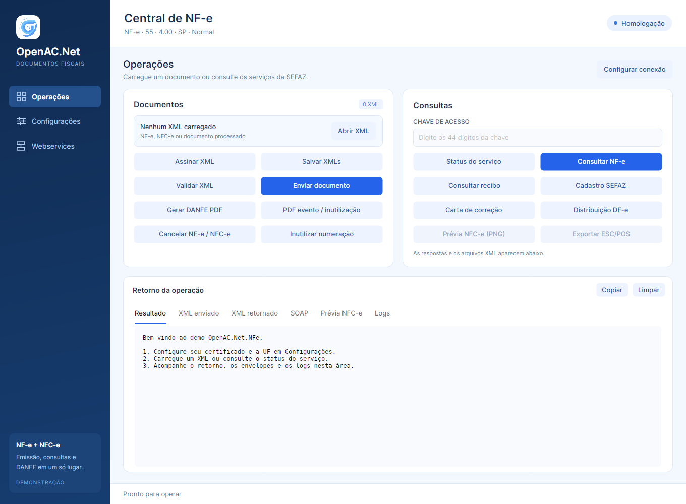

# OpenAC.Net.NFe.Demo

Demo desktop em Avalonia 12 e .NET 10, baseado no demo do CT-e. O tema Fluent usa tons de azul, com navegação entre operações, configurações e webservices.



## Executar

Na raiz do repositório, com o SDK .NET 10 instalado:

```sh
dotnet run --project src/OpenAC.Net.NFe.Demo
```

Requer uma sessão gráfica no Windows, Linux ou macOS.

## Operações

- Carregar um ou vários XMLs `NFe` ou `nfeProc` das versões 3.10 e 4.00.
- Assinar com certificado A1 (PFX/P12) ou certificado com chave privada disponível no repositório do sistema. Para NFC-e 4.00, gerar QR Code 2.00 ou 3.00.
- Validar identificação, XSD da versão do documento, assinatura presente e protocolo dos documentos processados.
- Enviar NF-e/NFC-e 4.00, consultar recibo, chave de acesso, status, cadastro e distribuição DF-e.
- Enviar cancelamento, carta de correção de NF-e e inutilização de numeração.
- Exportar XMLs, incluindo protocolos após autorização.
- Gerar DANFE PDF (NF-e e NFC-e), PDF de evento e PDF de inutilização.
- Gerar prévia NFC-e em PNG e exportar os comandos ESC/POS em 32 ou 48 colunas.
- Inspecionar resultado, XML enviado, XML retornado, envelopes SOAP e histórico de operações.

## Configurar e usar

1. Em **Configurações**, selecione modelo, UF, ambiente e forma de emissão. O padrão é **homologação**. Informe o certificado e a senha para operações assinadas ou comunicação com a SEFAZ.
2. Confira o diretório de schemas XSD. Os schemas da biblioteca são copiados para a saída da compilação. Configure o diretório de documentos e as opções de gravação de XML e SOAP.
3. Para NFC-e, configure a versão do QR Code; o QR Code 2.00 exige identificador e CSC. Escolha a largura do PDF em 58 ou 80 mm e as colunas do cupom em 32 ou 48.
4. Em **Operações**, abra os XMLs e confira se as configurações correspondem aos dados dos documentos. O demo preserva o ambiente e os dados do XML carregado.
5. Assine e valide quando necessário. Para comunicação, use documentos **4.00**. A versão **3.10** atende operações locais.
6. A autorização síncrona aceita um documento; a assíncrona aceita até 50 NF-e modelo 55. NFC-e usa envio síncrono individual. O recibo retornado e as cópias assinadas ficam disponíveis na sessão para consultar o processamento.
7. Use **Salvar XMLs** para exportar os documentos carregados/assinados ou os documentos processados após autorização. No envio assíncrono, consulte o recibo para associar os protocolos.

O demo cria um `IOpenNFeClient` com as opções selecionadas para cada operação, seguindo o CT-e atual. A biblioteca captura as configurações no construtor; alterações posteriores na tela são aplicadas ao criar o próximo cliente. Os documentos são fornecidos pelas solicitações explícitas da API NF-e.

As configurações são salvas em `OpenAC.Net/NFe.Demo/nfe.json` dentro do diretório de dados locais do usuário. A senha do certificado e o CSC permanecem somente na sessão. Os logs visíveis são um histórico da sessão. Em **Webservices**, consulte os endereços resolvidos para a configuração selecionada, carregue um catálogo XML compatível com a biblioteca ou exporte o catálogo em uso.

O botão **Cancelar operação** solicita cancelamento por `CancellationToken`. As operações com a SEFAZ usam os serviços reais; os testes usam transporte simulado.

## Comandos de impressão local

Fornecer argumentos mantém o modo de linha de comando, sem iniciar Avalonia:

```sh
dotnet run --project src/OpenAC.Net.NFe.Demo -- danfe nota.xml danfe.pdf
dotnet run --project src/OpenAC.Net.NFe.Demo -- evento evento.xml evento.pdf
dotnet run --project src/OpenAC.Net.NFe.Demo -- inutilizacao procInutNFe.xml inutilizacao.pdf
dotnet run --project src/OpenAC.Net.NFe.Demo -- escpos nfce.xml nfce.bin 48
dotnet run --project src/OpenAC.Net.NFe.Demo -- escpos-preview nfce.xml nfce.png 32
```

Esses comandos geram arquivos locais. Para listar a ajuda, use `-- --help`.

## Testes

A partir de `src`:

```sh
dotnet test --project OpenAC.Net.NFe.Tests/OpenAC.Net.NFe.Tests.csproj
```

Os testes TUnit da biblioteca verificam isolamento da configuração capturada, preservação dos documentos originais, autorização individual e em lote, chamadas concorrentes, cancelamento, respostas SOAP e impressão.
